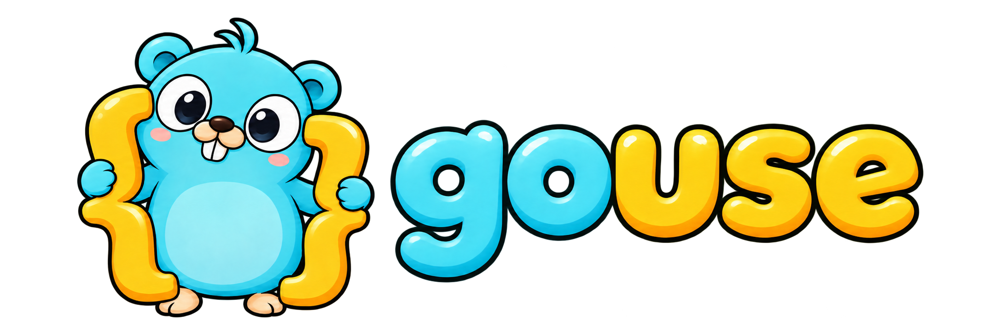
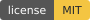
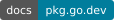

<h1 align="center">
  
</h1>

<p align="center">
  Focused Go utilities with explicit APIs and predictable behavior.<br>
  <strong>Go 1.26.0+</strong> &middot; Standard library only
</p>

<p align="center">
  <a href="https://github.com/muhammaadreza/gouse/releases"></a>
  <a href="go.mod"></a>
  <a href="https://github.com/muhammaadreza/gouse/actions/workflows/ci.yml"></a>
  <a href="LICENSE"></a>
  <a href="https://pkg.go.dev/github.com/muhammaadreza/gouse/env"></a>
</p>

<p align="center">
  <a href="#installation">Installation</a> &middot;
  <a href="#quick-start">Quick start</a> &middot;
  <a href="#packages">Packages</a> &middot;
  <a href="#documentation">Documentation</a> &middot;
  <a href="#testing">Testing</a>
</p>

## Installation

Requires Go **1.26.0** or later. From your application's Go module, run:

```sh
go get github.com/muhammaadreza/gouse/env@latest
```

Import the package as `github.com/muhammaadreza/gouse/env`. All packages belong
to the single module `github.com/muhammaadreza/gouse` and share one version.

Before the first version tag, `@latest` resolves to a pseudo-version identifying
a commit on the repository's default branch. Once releases are tagged, it selects
the latest available release.

## Quick start

Read configuration into a Go struct with the `env` package:

```go
package main

import (
    "fmt"
    "log"

    "github.com/muhammaadreza/gouse/env"
)

type Config struct {
    Port  int  `env:"PORT" fallback:"8080"`
    Debug bool `env:"DEBUG"`
}

func main() {
    cfg, err := env.Load[Config](env.WithPrefix("APP_"))
    if err != nil {
        log.Fatal(err)
    }
    fmt.Println(cfg.Port, cfg.Debug)
}
```

With `APP_PORT=9000` and `APP_DEBUG=true`, this prints:

```text
9000 true
```

## Packages

| Package | Purpose |
| --- | --- |
| [env](env/README.md) | Decode environment variables, dotenv files, and ordered custom sources into typed structs. |

The `env` package supports:

- Explicit tags, prefixes, defaults, and required/nonempty checks.
- Dotenv files, optional files, and ordered custom sources.
- Custom text decoding and parent validation.

Failed decoding or validation leaves the destination unchanged. Process
environment changes require an explicit `Export` call.

## Documentation

- [Package reference on pkg.go.dev](https://pkg.go.dev/github.com/muhammaadreza/gouse/env)
- [Configuration guide and API overview](env/README.md)
- [Tags, defaults, and empty values](env/README.md#tags-absent-values-and-empty-text)
- [Supported types and custom decoders](env/README.md#type-support-map)
- [Validation](env/README.md#parent-validation)
- [Errors and privacy](env/README.md#error-categories-and-privacy)

Browse the package documentation locally:

```sh
go doc github.com/muhammaadreza/gouse/env
```

## Testing

Run all package checks from the repository root:

```sh
go test ./...
go vet ./...
go test -race ./...
```

CI also checks formatting, the minimum Go version, and the supported Go versions
on Linux, macOS, and Windows. See the [workflow](.github/workflows/ci.yml) for the
exact versions and checks.

## License

The Go source code is licensed under the [MIT License](LICENSE). Artwork credits
are listed below.

## Artwork

The mascot is based on the [Go Gopher](https://go.dev/wiki/Gopher)
by Renee French, whose original design is licensed under
[CC BY 4.0](https://creativecommons.org/licenses/by/4.0/).

The pose, coloring, and wordmark were adapted for gouse.
